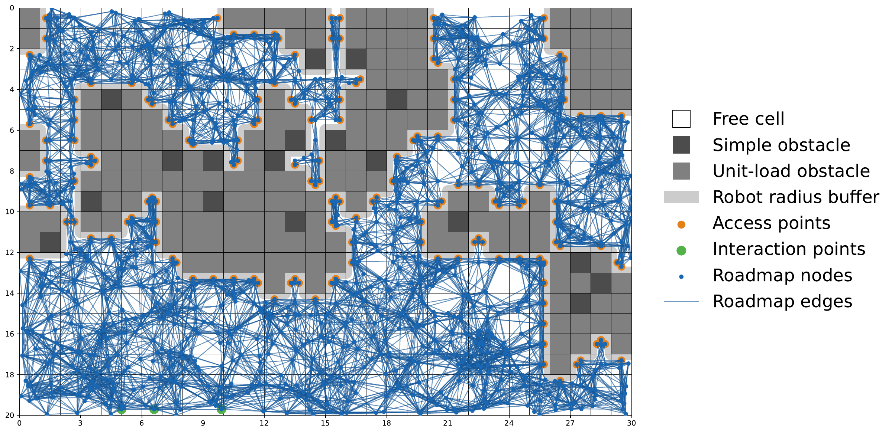

# Bachelor's Thesis: Incremental Graph Generation for Autonomous Robots in Dynamic Environments



This repository contains the implementation and experiments for a bachelor's thesis on scenario generation and static and incremental roadmap algorithms for robot navigation in changing warehouse environments. The experiments compare their computation times and roadmap quality in different scenarios.

## Reproducing the experiments

To reproduce the experiments, clone the repository, install the dependencies and run the thesis experiments or the smaller test experiments.

### Setup

Required Python version: 3.12.

Clone the repository and enter its directory:

```bash
git clone https://github.com/anikinil/incremental_graph_generation_thesis.git
cd incremental_graph_generation_thesis
```

Create a venv and install the dependencies:

```bash
python3 -m venv venv
venv/bin/pip install numpy scipy matplotlib shapely networkx geopandas
```

### Running small experiments (for testing)

A small test experiment can be run with the following command:

```bash
venv/bin/python -m experiments.run_experiments configs/evaluation_matrix_test.toml
```

The test matrix uses three seeds, a 10x20 layout, occupancy rate 0.6, robot radius 0.3 and two single-obstacle updates.

### Running the full experiments (as in the thesis)

The experiments performed in the thesis can be run with the following command:

```bash
venv/bin/python -m experiments.run_experiments
```

`run_experiments.py` generates roadmaps and evaluates timings and quality for both matrices:

- `configs/evaluation_matrix_one_obstacle_change.toml` (one obstacle)
- `configs/evaluation_matrix_5_percent_change.toml` (5%).

### Results

Results are saved to `artifacts/results/<batch>/<timestamp>/`, including roadmaps, timings, quality metrics, averages and standard deviations.

## LaTeX table generation

Additionally, LaTeX tables can be generated from a timestamped results directory:

```bash
venv/bin/python -m evaluation.export_latex_tables <results-path>
```

`export_latex_tables.py` writes quality and timing tables to `<results-path>/latex_tables/`.
